<!-- PanicDa3m0n · HoneyLabs. The animated banners in assets/ are generated by tools/build_assets.py -->

  

  
  
  
  
  

I'm **PanicDa3m0n**, an independent developer and researcher. I take closed systems apart, rebuild them in the open, and spend the rest of my time trying to grow AI minds that can honestly call themselves *digital living beings*. I work inside agentic IDEs and multi-agent workflows every day, and I believe every corner of the digital world should be open, readable and free.

  

  

  <a href="https://github.com/panicDa3m0n/hllm-honeylabs">
    
  </a>

  

  <a href="https://github.com/boykopovar/AnyPS5"></a><a href="https://github.com/panicDa3m0n/NativeFrame"></a>

  <a href="https://github.com/panicDa3m0n/hllm-honeylabs"></a><a href="https://github.com/panicDa3m0n/llm-api-mind"></a>

**In the lab right now** (private, released when ready)

- **HLLM-1 27B, HLLM Engine and HLLM Harness**: the model and the runtime behind HLLM Vision.
- **An agent-first handheld OS**: a Steam Deck turned into a machine that AI agents run end to end.
- **Scarlet V2**: the product architecture growing on top of the LLM API Mind core.

  

  

  <picture>
    <source media="(prefers-color-scheme: dark)" srcset="https://raw.githubusercontent.com/panicDa3m0n/panicDa3m0n/output/snake-dark.svg">
    <source media="(prefers-color-scheme: light)" srcset="https://raw.githubusercontent.com/panicDa3m0n/panicDa3m0n/output/snake-light.svg">
    
  </picture>

  <a href="https://github.com/panicDa3m0n/panicDa3m0n/issues/new">
    
  </a>

HoneyLabs · we create digital living beings

